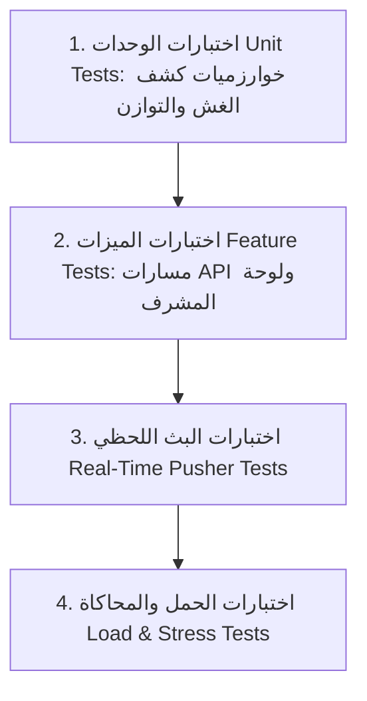

# خطة ترقية لوحة التحكم واختبارها (Dashboard Supercharge Roadmap)
# Deceit Online — Top 5 Dashboard Enhancements & Comprehensive Testing Strategy

هذه الوثيقة تقدم خطة تطويرية وتنفيذية شاملة للارتقاء بلوحة تحكم المشرفين (**Admin Dashboard**) للعبة **ديسيت أونلاين**، من خلال اختيار **أهم 5 ميزات جوهرية** يحتاجها الخادم للمراقبة، التوازن، ومكافحة الغش، بالإضافة إلى **استراتيجية اختبار مؤتمتة متكاملة** لضمان استقرار النظام تحت الضغط العالي.

---

```
                       ┌──────────────────────────────────────────────────┐
                       │      ديسيت أونلاين: ركائز تطوير لوحة التحكم      │
                       └──────────────────────────────────────────────────┘
                                                │
         ┌──────────────────┬───────────────────┼──────────────────┬──────────────────┐
         ▼                  ▼                   ▼                  ▼                  ▼
   1. وضع المراقب    2. موازنة الأدوار   3. مكافحة الغش    4. التعديل الحي     5. محاكي الضغط
    (Live Spectator)  (Role Analytics)   (Anti-Teaming)    (Dynamic Config)   (Bot Stress-Test)
```

---

## 1. أهم 5 ميزات نحتاجها لترقية لوحة التحكم (Top 5 Enhancements)

---

### الميزة الأولى: شاشة المراقبة الحية الشاملة ومجرى الأحداث (Live Match Spectator & God-Mode Stream)

#### المشكلة الحالية:
حالياً، تعرض صفحة `/admin/rooms` قائمة الغرف وعدد اللاعبين الثابت، ويتطلب معرفة المستجدات الضغط على تحديث الصفحة أو الدخول يدوياً.

#### الترقية المطلوبة:
- **تحديث حي فوري (Live Pusher Admin Channel)**:
  - استقبال أحداث المباريات في الوقت الفعلي على قناة خاصة بالمشرفين (`private-admin-monitor`).
- **خريطة كشف الأدوار (God-Mode Role Reveal)**:
  - عرض شبكي تفاعلي (Interactive Grid) لجميع اللاعبين داخل الغرفة المحددة:
    - بطاقة كل لاعب توضح دوره السري ولونه (`Kingdom: Blue`, `Shadow: Red`, `Neutral: Purple`).
    - مؤشر حي للاتصال (Online / Reconnecting / Offline).
    - سهم متحرك يوضح من استهدف من في الليل (Night Action Target Arrows).
    - خريطة حرارية حية للتصويت في النهار (Vote Heatmap) توضح تركز الأصوات قبل انتهاء الوقت.
- **سجل الأحداث المباشر (Live Ticker / Action Feed)**:
  - شريط جانبي يسرد كل حركة تحدث لحظة بلحظة:
    ```text
    [18:45:12] المخرب قام بتعطيل قدرة الطبيب.
    [18:45:14] القاتل استهدف اللاعب "سالم".
    [18:45:18] اكتملت جاهزية جميع اللاعبين - تخطي مؤقت الليل.
    ```

---

### الميزة الثانية: تحليلات توازن الأدوار واقتصاد اللعبة (Role Balance & Economy Analytics)

#### المشكلة الحالية:
التحليلات الحالية تقتصر على عدد المباريات الإجمالي ونسبة فوز كل فصيل دون التعمق في كفاءة الأدوار الفردية أو حركة العملات الذهبية.

#### الترقية المطلوبة:
- **مصفوفة توازن الأدوار الـ 22 (Role Win-Rate Matrix)**:
  - رسوم بيانية تفاعلية (باستخدام Chart.js أو ApexCharts):
    - نسبة فوز الفريق عند تواجد دور معين (مثال: هل وجود `slasher` يرفع فوز الظلال إلى 80%؟).
    - معدل البقاء على قيد الحياة لكل دور في الليلة الأولى (Night 1 Mortality Rate).
    - أكثر الأدوار استهدافاً بالقتل أو التصويت النهاري.
- **مقياس اقتصاد العملات (Dcoins Sink vs. Faucet Velocity)**:
  - تتبع تدفق العملات:
    - **مصادر التوليد (Faucets)**: مكافآت الإعلانات، مكافآت الفوز، الهدايا اليومية.
    - **قنوات الاستهلاك (Sinks)**: فتح الأدوار الجديدة، تخصيص المظاهر.
    - معدل التضخم الاقتصادي ومتوسط رصيد اللاعب النشط.

---

### الميزة الثالثة: منظومة مكافحة الغش والتحالفات المشبوهة (Anti-Teaming & Moderation Suite)

#### المشكلة الحالية:
في ألعاب الخداع الاجتماعي (Social Deduction)، أكبر خطر يفسد متعة اللاعبين هو وجود لاعبين في نفس الغرفة يتواصلون خارجياً (عبر ديسكورد أو مكالمة) لكشف الأدوار لبعضهم البعض (Teaming/Cheating).

#### الترقية المطلوبة:
- **كاشف تطابق عنوان IP والجهاز (Collusion & Multi-Account Detector)**:
  - تنبيه فوري أحمر في اللوحة إذا وُجد لاعبان في نفس الغرفة بنفس الـ IP أو بصمة الجهاز (Device Fingerprint) وكان أحدهما من المملكة والآخر من الظلال.
- **الحظر الخفي المؤقت (Shadow-Ban Toggle)**:
  - إمكانية عزل اللاعب الغشاش دون علمه بحيث لا ينضم مستقبلاً إلا لغرف تحتوي على بوتات أو لاعبين محظورين مثله.
- **فلتر الكلمات المسيئة الآلي (Automated Chat Toxicity Watchdog)**:
  - التقاط الكلمات النابية في الشات وتنبيه المشرف فوراً بنسخة من المحادثة مع إمكانية كتم اللاعب (`Mute`) لمدة 24 ساعة بنقرة واحدة.

---

### الميزة الرابعة: لوحة الضبط المباشر لقواعد اللعبة دون إعادة نشر (Dynamic Live Config & Hot-Tuning)

#### المشكلة الحالية:
تغيير مدة الليل أو النهار أو تعطيل دور يعاني من خلل توازني يتطلب تعديل الكود وإعادة رفع السيرفر.

#### الترقية المطلوبة:
- **شاشة الإعدادات الحية (`/admin/settings/game-tuning`)**:
  - مدة المؤقتات الافتراضية (مؤقت النهار، الليل، التصويت، كشف الأدوار).
  - قائمة تبديل الأدوار المسموحة (Enable/Disable Roles Switcher): إيقاف دور فوراً عن الظهور في التوزيع العشوائي لأي غرفة جديدة.
  - مكافأة العملات للجولة (تعديل كمية الذهب الممنوحة عند الفوز أو إنجاز المهام).
  - حفظ الإعدادات في جدول `app_settings` أو Redis، ليقرأها `RoomManager` تلقائياً.

---

### الميزة الخامسة: لوحة محاكاة الضغط وتوليد المباريات الوهمية (Bot Match Spawner & Load Testing Panel)

#### المشكلة الحالية:
اختبار أداء السيرفر وقدرته على تحمل 50 أو 100 غرفة نشطة في وقت واحد يتطلب كتابة أكواد اختبار يدوية كل مرة.

#### الترقية المطلوبة:
- **زر التشغيل التجريبي المباشر (Simulate 10 Matches)**:
  - من داخل لوحة التحكم، يمكن للمشرف الضغط على "توليد مباريات اختبارية":
    - يُنشئ السيرفر 10 غرف مليئة بالبوتات الذكية تلقائياً.
    - تلعب البوتات الجولات كاملة وتصوّت حتى ينتهي الجيم.
  - قياس استهلاك الذاكرة (Memory Usage)، زمن استجابة الـ API، وسرعة وصول رسائل Pusher مباشرة أمام المشرف.

---

## 2. الهيكلة التقنية لتنفيذ الميزات (Implementation Blueprints)

### قاعدة البيانات والمخطط (Database Schema Updates)

```php
// database/migrations/2026_01_01_000010_create_game_configurations_table.php
Schema::create('game_configurations', function (Blueprint $table) {
    $table->string('key')->primary();
    $table->text('value');
    $table->string('description')->nullable();
    $table->timestamps();
});

// database/migrations/2026_01_01_000011_create_suspicious_activities_table.php
Schema::create('suspicious_activities', function (Blueprint $table) {
    $table->id();
    $table->string('room_code', 10);
    $table->string('player_a_id', 64);
    $table->string('player_b_id', 64);
    $table->string('reason'); // e.g. 'SAME_IP_OPPOSING_TEAMS'
    $table->string('ip_address', 45);
    $table->timestamps();
});
```

---

## 3. خطة الاختبار الشاملة للوحة والميزات (Testing Strategy)

لضمان عمل لوحة التحكم والميزات الـ 5 دون أي ثغرات، نعتمد على 4 مستويات من الاختبارات:



---

### المستوى الأول: اختبارات الوحدات (Unit Tests)

اختبار خوارزمية كشف الـ IP المشترك بين لاعبين متنافسين:

```php
// tests/Unit/AntiCheatEngineTest.php
namespace Tests\Unit;

use Tests\TestCase;
use App\Services\Moderation\AntiCheatEngine;

class AntiCheatEngineTest extends TestCase
{
    public function test_flags_opposing_faction_players_with_same_ip(): void
    {
        $room = [
            'roomCode' => 'ABCD',
            'players' => [
                ['playerId' => 'p1', 'ip' => '192.168.1.50', 'faction' => 'kingdom'],
                ['playerId' => 'p2', 'ip' => '192.168.1.50', 'faction' => 'shadow'],
                ['playerId' => 'p3', 'ip' => '10.0.0.1',     'faction' => 'kingdom'],
            ]
        ];

        $suspiciousPairs = AntiCheatEngine::detectTeaming($room);

        $this->assertCount(1, $suspiciousPairs);
        $this->assertEquals('p1', $suspiciousPairs[0]['playerA']);
        $this->assertEquals('p2', $suspiciousPairs[0]['playerB']);
        $this->assertEquals('SAME_IP_OPPOSING_TEAMS', $suspiciousPairs[0]['reason']);
    }
}
```

---

### المستوى الثاني: اختبارات الميزات والواجهات (Feature Tests)

اختبار مسارات الإعدادات الحية وحظر اللاعبين المباشر:

```php
// tests/Feature/AdminLiveTuningTest.php
namespace Tests\Feature;

use App\Models\User;
use Illuminate\Foundation\Testing\RefreshDatabase;
use Tests\TestCase;

class AdminLiveTuningTest extends TestCase
{
    use RefreshDatabase;

    public function test_admin_can_update_live_game_settings(): void
    {
        $admin = User::factory()->create(['role' => 'admin']);

        $res = $this->actingAs($admin)->post('/admin/settings/tuning', [
            'dayTimerSeconds' => 90,
            'nightTimerSeconds' => 45,
            'disabledRoles' => ['hermit', 'forger'],
        ]);

        $res->assertSessionHas('success');
        $this->assertDatabaseHas('game_configurations', [
            'key' => 'dayTimerSeconds',
            'value' => '90',
        ]);
    }
}
```

---

### المستوى الثالث: اختبارات البث المباشر وقنوات الإدارة (Real-Time Pusher Tests)

اختبار بث حركة الليل للمشرفين في الوقت الحقيقي:

```php
// tests/Feature/AdminSpectatorStreamTest.php
namespace Tests\Feature;

use App\Services\GameEngine\RoomManager;
use App\Services\PusherService;
use Tests\TestCase;

class AdminSpectatorStreamTest extends TestCase
{
    public function test_night_action_broadcasts_to_admin_monitor_channel(): void
    {
        PusherService::fake();

        $roomData = RoomManager::createRoom('مستضيف');
        $roomCode = $roomData['room']['roomCode'];
        $hostId = $roomData['hostPlayer']['playerId'];

        // Submit action
        RoomManager::submitNightAction($roomCode, $hostId, 'target_123');

        // Verify Pusher broadcast was triggered on private-admin-monitor
        PusherService::assertBroadcastToRoom(
            $roomCode,
            's_room_snapshot'
        );
    }
}
```

---

### المستوى الرابع: اختبار محاكاة الضغط وتوليد 10 مباريات دفعة واحدة (Stress & Load Simulation Test)

إنشاء أمر Artisan لاختبار التحمل في ثوانٍ:
`php artisan test:simulate-load --rooms=10 --bots-per-room=8`

```php
// tests/Feature/StressSimulationTest.php
namespace Tests\Feature;

use App\Services\GameEngine\RoomManager;
use App\Services\PusherService;
use Tests\TestCase;

class StressSimulationTest extends TestCase
{
    public function test_can_spawn_and_run_ten_concurrent_bot_matches(): void
    {
        PusherService::fake();

        $rooms = [];
        // Spawn 10 rooms with 6 bots each
        for ($i = 0; $i < 10; $i++) {
            $created = RoomManager::createRoom("مضيف_تجريبي_{$i}");
            $code = $created['room']['roomCode'];
            
            for ($b = 0; $b < 5; $b++) {
                RoomManager::addBot($code);
            }
            $rooms[] = $code;
        }

        $this->assertCount(10, $rooms);

        // Advance all rooms through ROLE_REVEAL and NIGHT
        foreach ($rooms as $code) {
            $room = RoomManager::getRoom($code);
            $this->assertCount(6, $room['players']);
            RoomManager::startGame($code, $room['hostPlayerId']);
            
            $activeRoom = RoomManager::getRoom($code);
            $this->assertEquals('ROLE_REVEAL', $activeRoom['phase']);

            // Fast forward phase
            RoomManager::advanceMatchLoop($activeRoom);
            $this->assertEquals('NIGHT', $activeRoom['phase']);
        }
    }
}
```

---

## 4. خطة التنفيذ خطوة بخطوة (Step-by-Step Implementation Roadmap)

```
[الأسبوع 1] ──> إنشاء شاشة المراقبة الحية (Live Spectator Grid) + دمج Pusher Channel للأدمن
       │
[الأسبوع 2] ──> بناء مصفوفة توازن الأدوار والرسوم البيانية (Role Balance & ApexCharts)
       │
[الأسبوع 3] ──> تفعيل رادار مكافحة التحالف والغش (Anti-Teaming Detection & Chat Toxicity)
       │
[الأسبوع 4] ──> إطلاق شاشة الضبط الحي (Live Hot-Tuning) + محاكي ضغط البوتات في اللوحة
```

---

## 5. الخلاصة

بتطبيق هذه الميزات الخمس:
1. **المراقبة الحية الفورية (Live Spectator)** تمنح المشرفين رؤية شاملة لمجريات أي مباراة دون تخمين.
2. **تحليلات توازن الأدوار (Role Balance Analytics)** تضمن توازن قوى اللعبة استناداً لبيانات حقيقية.
3. **منظومة مكافحة التحالف (Anti-Teaming Suite)** تحمي متعة اللعبة ونزاهتها من المتآمرين.
4. **الضبط الديناميكي (Dynamic Hot-Tuning)** يتيح مرونة هائلة لتغيير المؤقتات وتفعيل/تعطيل الأدوار بلحظة واحدة.
5. **لوحة محاكاة الضغط (Bot Stress Testing)** توفر بيئة اختبار ذاتية مريحة للتأكد من صمود السيرفر قبل أي حملة ترويجية أو إطلاق لآلاف اللاعبين.

