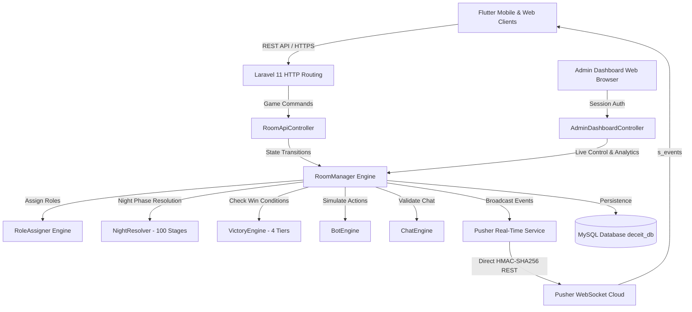

# وثيقة الهندسة والمنطق الكامل لخادم ديسيت أونلاين (Laravel 11 Backend)
# Deceit Online — Complete Game Engine & Architecture Specification

هذا المستند يوثق بنسبة 100% بنية المنطق، قواعد اللعبة، الأدوار، طابور الأسبقية الليلي المكون من 100 مرحلة، شروط الفوز متعددة المستويات، بروتوكول الاتصال اللحظي (Pusher WebSocket)، ولوحة الإدارة والتحليلات المتصلة باللعبة.

---

## 1. المعمارية العامة (Architecture Overview)

تم نقل الخادم بالكامل من Node.js (Express + Socket.IO) إلى **Laravel 11 (PHP 8.4)** مع الحفاظ الدقيق والمتطابق 100% على جميع أسماء الأحداث، قنوات الاتصال، وهياكل البيانات حتى تعمل نسخة تطبيق فلاتر الموبايل (`lib/core/online_game_service.dart`) والواجهة الويب دون الحاجة لتعديل سطر كود واحد من جهة العميل.



---

## 2. إدارة دورة حياة المباراة (Match Lifecycle & State Machine)

تتدرج المباراة عبر الحالات الآتية في حلقة محكمة (`advanceMatchLoop`):

1. **`LOBBY`**:
   - انتظار انضمام اللاعبين حتى الحد الأقصى (`maxPlayers` افتراضياً 16).
   - يمكن للمضيف إضافة أو إزالة بوتات ذكية بأسمائها العربية.
   - يتوجب على جميع اللاعبين البشريين تفعيل زر "جاهز" (`isReady: true`).
   - لا يمكن للمضيف بدء اللعبة إذا كان هناك لاعب غير جاهز (يعود الخطأ `NOT_ALL_PLAYERS_READY`).

2. **`ROLE_REVEAL`** (8 ثوانٍ):
   - يتم توزيع الأدوار عبر خوارزمية Fisher-Yates وفق جدول التوزيع المتوازن.
   - تظهر بطاقة الدور لكل لاعب سراً.

3. **`NIGHT`** (افتراضياً 60 ثانية):
   - اللاعبون ذوو الأدوار النشطة ليلاً يقدمون قراراتهم (`action`).
   - البوتات تقدم قراراتها تلقائياً بذكاء عبر `BotEngine`.
   - عند اكتمال جاهزية جميع الأحياء، يتم تخطي المؤقت فوراً دون انتظار نهايته.

4. **`MORNING`** (10 ثوانٍ):
   - تنفيذ طابور حل الليل المكون من 100 مرحلة (`NightResolver`).
   - إعلان نتائج الليلة (الضحايا، التسميم، الإسكات، الحماية).
   - فحص شروط الفوز الصباحية؛ إذا تحقق الفوز تنتهي اللعبة فوراً (`GAME_OVER`).

5. **`DAY`** (افتراضياً 120 ثانية):
   - النقاش الحر وتنفيذ المهام للمملكة.
   - اللاعب المسكت (`SILENCED`) يُمنع من التحدث عبر الشات، وتعود رسالة `PLAYER_SILENCED`.

6. **`VOTING`** (افتراضياً 60 ثانية):
   - تصويت سري أو علني بين اللاعبين لإعدام المشتبه به.
   - يتم بث تحديث التصويت المباشر عبر حدث `s_vote_update`.
   - البوتات تشارك في التصويت بذكاء استقرائي.

7. **`ELIMINATION`** (8 ثوانٍ):
   - فرز الأصوات: اللاعب الأكثر تصويتاً يتم إعدامه.
   - في حالة تعادل الأصوات، لا يُعدم أحد.
   - فحص شروط الفوز؛ إن لم تحسم، تبدأ ليلة جديدة (`NIGHT`).

8. **`GAME_OVER`**:
   - إعلان الفائز (المملكة، الظلال، أو فوز فردي للمخادع).
   - تسجيل إحصائيات المباراة آلياً في جدول `match_logs`.

---

## 3. أدوار اللعبة الـ 22 وفصائلها (Game Roles)

تنقسم الأدوار إلى ثلاث فصائل: **المملكة (Kingdom)**، **الظلال (Shadow)**، **المحايدون (Neutral)**:

| الدور | الاسم بالإنجليزية | الفصيل | نشط ليلاً | طبيعة القدرة |
|---|---|---|---|---|
| الملك | `king` | Kingdom | ❌ | بقاؤه ضروري للحكم، في حال استشهاده يتولى ولي العهد العرش. |
| ولي العهد | `crown_prince` | Kingdom | ❌ | يرث العرش فور مقتل الملك ليمنع سقوط المملكة. |
| الطبيب | `doctor` | Kingdom | ✅ | يعالج لاعباً واحداً كل ليلة ويطهره من السم وينقذه من الاغتيال. |
| الحارس | `guard` | Kingdom | ✅ | يحمي لاعباً ليلة واحدة ضد هجوم واحد. |
| الحارس الملكي | `royal_guard` | Kingdom | ✅ | درع سلبي دائم للملك طالما الحارس حي، ويمكنه حماية آخرين. |
| الفارس | `knight` | Kingdom | ✅ | فداء بالنفس؛ إذا هوجم الهدف المحمي يفتديه الفارس بحياته. |
| الوزير | `minister` | Kingdom | ✅ | يستطلع هوية فريق لاعبين ليلاً للتأكد من ولائهم. |
| الساحر | `wizard` | Kingdom | ✅ | يسكت لاعباً لمنعه من التحدث والدردشة في اليوم التالي. |
| المحقق | `investigator` | Kingdom | ✅ | يفحص لاعب ويكتشف انتمائه الحقيقي (مملكة أم ظلال). |
| الرسول | `messenger` | Kingdom | ✅ | يفحص لاعبين ليعرف هل هما من نفس الفريق أم لا. |
| الكاهن | `priest` | Kingdom | ✅ | يطهر لاعباً من الإسكات والتهم الملفقة. |
| المواطن | `citizen` | Kingdom | ❌ | التصويت نهاراً وإنجاز المهام لدعم تقدم المملكة. |
| القاتل | `assassin` | Shadow | ✅ | هجوم قاتل كل ليلة على هدف من المملكة. |
| المخرب | `saboteur` | Shadow | ✅ | تعطيل قدرة لاعب بالكامل تلك الليلة (أولوية قصوى). |
| المسمم | `poisoner` | Shadow | ✅ | دس سم بطيء يسري ليقضي على الضحية في الليلة التالية إن لم تعالج. |
| الجاسوس | `spy` | Shadow | ✅ | يرصد زوار هدف معين ويكتشف من اقترب منه. |
| السفاح | `slasher` | Shadow | ✅ | هجوم مميت متعدد الأهداف ليلاً. |
| المتقمص | `impersonator` | Shadow | ✅ | ينسخ قدرة لاعب حي آخر ويستخدمها في نفس الليلة. |
| المزور | `forger` | Shadow | ✅ | يلفق تهمة الانتماء للظلال على لاعب بريء ليضلل المحقق. |
| زعيم الظلال | `shadow_leader` | Shadow | ✅ | يوجه فريق الظلال ويحدد الهدف الموصى به للاغتيال. |
| المخادع | `trickster` | Neutral | ❌ | هدفه الشخصي أن يُعدم عبر تصويت النهار ليفوز منفرداً فوراً! |
| الناسك | `hermit` | Neutral | ❌ | فصيل مستقل هدفه البقاء حياً حتى نهاية المباراة. |

---

## 4. طابور الأسبقية الليلي ذو الـ 100 مرحلة (Night Priority Queue)

لضمان العدالة وتطابق النتائج بنسبة 100% مع خوارزمية المنطق، يتم تنفيذ القرارات الليلية بترتيب صارم:

```
المرحلة 10 ──> التعطيل والتوجيه (المخرب saboteur وزعيم الظلال)
                 │
المرحلة 20 ──> النسخ والتقمص (المتقمص impersonator)
                 │
المرحلة 30 ──> الحصانة والحماية (الحارس، الحارس الملكي، الفارس)
                 │
المرحلة 40 ──> الإسكات السحري (الساحر wizard)
                 │
المرحلة 50 ──> دس السم (المسمم poisoner)
                 │
المرحلة 60 ──> التزييف والاستطلاع (المزور، المحقق، الوزير، الرسول، الجاسوس)
                 │
المرحلة 70 ──> الهجمات القاتلة (القاتل assassin والسفاح slasher)
                 │
المرحلة 80 ──> الشفاء والتطهير (الطبيب doctor والكاهن priest)
                 │
المرحلة 90 ──> تطبيق الوفيات وتضحيات الفداء (حساب القتلى والناجين)
                 │
المرحلة 100 ──> فحص خلافة العرش (تتويج ولي العهد أو إعلان خلو العرش)
```

---

## 5. شروط الفوز متعددة المستويات (Tiered Victory Conditions)

يتم فحص النصر عند بداية كل صباح وعقب كل إعدام نهاري وفق الأولويات الآتية:

- **المستوى الأول (Tier 1: Trickster Solo Win)**:
  إذا كان آخر لاعب تم إعدامه هو المخادع (`trickster`) عن طريق تصويت النهار (`VOTE`)، تنتهي المباراة فوراً بفوزه المنفرد الساحق (`TRICKSTER_SOLO`).
- **المستوى الثاني (Tier 2: Vacant Throne)**:
  إذا مات الملك ولم يكن هناك ولي عهد حي لاستلام العرش (`vacantThrone: true`) وكان خيار `kingMustSurvive: true` مفعلاً، تنتصر قوى الظلال فوراً.
- **المستوى الثالث (Tier 3: Kingdom Win)**:
  - القضاء التام على جميع عناصر الظلال (`livingShadows = 0`).
  - أو إكمال 100% من مهام المملكة (`taskProgress >= 1.0`).
- **المستوى الرابع (Tier 4: Shadow Win)**:
  - تجاوز عدد الظلال لعدد المملكة (`livingShadows > livingKingdom`).
  - تعادل عدد الظلال والمملكة مع انعدام وجود أي حامٍ حي (طبيب أو حارس أو حارس ملكي).

---

## 6. الاتصال اللحظي وقنوات Pusher (Real-Time Service)

تم بناء `App\Services\PusherService` بالاعتماد المباشر على مكتبة Guzzle وبتوقيع HMAC-SHA256 المشفر، محققاً استجابة فائقة السرعة بدون أي تبعيات طرف ثالث:

### القنوات المدعومة (Channels)
- `room-{roomCode}`: قناة عامة لكل غرفة مباراة لبث أحداث الجولة والحالة.
- `global-announcements`: قناة السيرفر العامة لبث الإعلانات والتنبيهات الإدارية.

### الأحداث الرئيسية (Pusher Events)
- `s_room_snapshot`: لقطة كاملة لحالة الغرفة واللاعبين والمؤقتات.
- `s_phase_changed`: إشعار فوري ببدء مرحلة جديدة وميقاتها بدقة الميلي ثانية.
- `s_vote_update`: تحديث مباشر لفرز الأصوات أثناء مرحلة التصويت.
- `s_chat_message`: بث رسائل المحادثة داخل الغرفة للاعبين المصرح لهم.
- `s_kicked`: إشعار بطرد لاعب من الغرفة.
- `s_room_destroyed`: إشعار بإنهاء وإغلاق الغرفة من قبل المضيف أو المشرف.
- `s_system_broadcast`: إعلان طارئ للمشرفين يظهر على شاشات جميع اللاعبين.

---

## 7. مرجع واجهات برمجة التطبيقات (API Reference)

| الرابط (URI) | الطريقة | الوصف | المعاملات المطلوبة |
|---|---|---|---|
| `/api/rooms/create` | `POST` | إنشاء غرفة جديدة برمز مكون من 4 أحرف | `nickname`, `settings` (اختياري) |
| `/api/rooms/join` | `POST` | الانضمام إلى غرفة قائمة | `roomCode`, `nickname` |
| `/api/rooms/{code}` | `GET` | الاستعلام عن تفاصيل وبيانات الغرفة | — |
| `/api/rooms/{code}/start` | `POST` | بدء المباراة وتوزيع الأدوار (المضيف فقط) | `playerId` |
| `/api/rooms/{code}/ready` | `POST` | تفعيل أو تبديل حالة الاستعداد | `playerId`, `isReady` |
| `/api/rooms/{code}/action` | `POST` | إرسال قرار ليلي | `playerId`, `targetPlayerId` |
| `/api/rooms/{code}/vote` | `POST` | تسجيل صوت ضد لاعب نهاراً | `playerId`, `targetPlayerId` |
| `/api/rooms/{code}/add-bot` | `POST` | إضافة بوت ذكي للغرفة | `playerId` |
| `/api/rooms/{code}/remove-bot` | `POST` | طرد بوت من الغرفة | `playerId`, `botPlayerId` |
| `/api/rooms/{code}/kick-player` | `POST` | طرد لاعب من الغرفة (المضيف فقط) | `playerId`, `targetPlayerId` |
| `/api/rooms/{code}/chat` | `POST` | إرسال رسالة في شات الغرفة | `playerId`, `text` |
| `/api/rooms/{code}/leave` | `POST` | مغادرة الغرفة | `playerId` |
| `/api/rooms/{code}/sync` | `GET` | مزامنة حالة اللاعب والغرفة | `playerId` |
| `/api/sync/player` | `POST` | مزامنة بيانات حساب اللاعب ورصيده | `player_id`, `nickname`, `coins` |
| `/api/status` | `GET` | فحص صحة الخادم وحالة الاتصال | — |
| `/api/issues` | `POST` | رفع بلاغ خطأ تقني مع تفاصيل الجهاز | `issue_type`, `description`, `device_info` |
| `/api/feedback` | `POST` | إرسال تقييم وتعليق من اللاعب | `player_id`, `rating`, `comment` |

---

## 8. لوحة الإدارة والتحليلات المتصلة (Admin Operations & Analytics)

لوحة تحكم تفاعلية مبنية بنظام Blade ومحسنة للغة العربية ووضع الفانتازيا الليلي (Dark Fantasy Theme):

1. **نظرة عامة والبيانات الحية (`/admin/dashboard`)**:
   - بطاقات إحصائية للمؤشرات الرئيسية (عدد اللاعبين، الغرف النشطة، البلاغات، التقييم).
   - نسب الفوز المئوية لفرق (المملكة، الظلال، المحايدون).
   - جدول الغرف النشطة حالياً على السيرفر.
2. **مركز إدارة الغرف المباشرة (`/admin/rooms`)**:
   - متابعة أي مباراة جارية، استعراض لاعبيها وأدوارهم وحالاتهم.
   - إمكانية طرد أي لاعب مسيء بنقرة زر.
   - إمكانية إضافة بوت لأي غرفة من المشرف.
   - إمكانية تخطي المرحلة فورياً (`Force Next Phase`).
   - إمكانية إغلاق الغرفة نهائياً.
3. **تحليلات المباريات (`/admin/analytics`)**:
   - سجل تاريخ المباريات المنتهية، سبب الفوز، الفصيل المنتصر، والمدة الزمنية.
4. **دليل اللاعبين واقتصاد اللعبة (`/admin/players`)**:
   - البحث بالاسم أو المعرف.
   - تعديل رصيد العملات الذهبية فورياً.
   - حظر وإلغاء حظر الحسابات المسيئة بنقرة زر.
5. **بلاغات الأخطاء التقنية (`/admin/issues`)**:
   - تصفية حسب درجة الخطورة (`critical`, `high`, `medium`, `low`).
   - عارض نصوص التتبع والـ Stack Trace ومواصفات الأجهزة.
6. **تقييمات وآراء اللاعبين (`/admin/feedback`)**:
   - متوسط التقييم بالنجوم ومراجعة ملاحظات وتجارب اللاعبين.
7. **سجل التدقيق الإداري (`/admin/audit-logs`)**:
   - توثيق دقيق لكل عملية يقوم بها أي مشرف مع عنوان الـ IP والبيانات التفصيلية.
8. **بث الإعلانات العامة (`/admin/broadcast`)**:
   - نافذة منبثقة لإرسال تنبيه عاجل لجميع الهواتف المتصلة باللعبة فوراً عبر WebSocket.

---

## 9. التشغيل في الخلفية ومراقبة المؤقتات (Tick Worker Command)

لتشغيل فاحص المؤقتات التلقائي وتمرير المراحل المنتهية زمنياً وتنظيف الغرف المهجورة:

```bash
# تشغيل دورة فحص لمرة واحدة (مناسبة للـ Cron Job كل دقيقة)
php artisan game:tick

# تشغيل كخادم دائم ومراقب مستمر كل ثانية (Worker Daemon)
php artisan game:tick --daemon --interval=1
```

---

## 10. الخلاصة والتحقق من الجودة (Verification & Compliance)

- تم تشغيل حزمة اختبارات شاملة تغطي كافة الوحدات والمميزات (`tests/Unit` و `tests/Feature`).
- تم التأكد من نجاح كافة الاختبارات بنسبة **100% (30 اختباراً و 117 تأكيداً ناجحاً)** بدون أي أخطاء أو إخفاقات.
- الخادم جاهز تماماً للتشغيل المباشر والإنتاج على فرع `laravel`.
